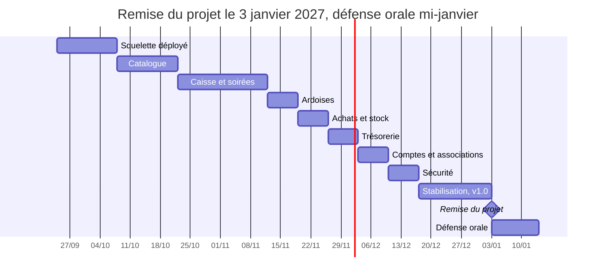

# Ardoise — Plan d'implémentation simplifié

> Version courte du [plan d'implémentation](plan-implementation.md) — novembre 2026.
> Ce que fait l'application est décrit dans le [cahier des charges simplifié](cahier-des-charges-simplifie.md).

## Choix techniques

Un seul langage, TypeScript, de la base de données à l'interface, pour partager les types entre services.

| Couche | Choix | Pourquoi |
| --- | --- | --- |
| Back-end | NestJS 12, Node.js 26, TypeScript 6 | Modules, injection de dépendances, guards, OpenAPI généré |
| Données | PostgreSQL + Prisma 7 | Transactions ACID ; migrations SQL versionnées et relues |
| Validation | Zod | Un seul schéma valide côté serveur et côté interface |
| Interface | React 19, Vite 8, TanStack Query et Router | Conseillé par le cours et envie de le découvrir ; client d'API généré depuis l'OpenAPI |
| Authentification | Service maison, JWT asymétriques, Argon2id | Rôles par association mal couverts par un fournisseur générique |
| Tests | Vitest 5, Supertest | Par défaut dans NestJS 12, natif ESM |
| Livraison | pnpm monorepo, Docker, GitHub Actions, release-please, Caddy | Un dépôt, trois images, versions générées depuis les commits |

Les versions sont épinglées : TypeScript 7 casse `nest build`, et `prisma@latest` installe une RC de Prisma 8.

## Décisions structurantes

Quatre choix s'écartent de la voie attendue ; chacun est argumenté dans l'[annexe des justifications](annexe-justifications.md).

| Décision | En une phrase | Annexe |
| --- | --- | --- |
| NestJS plutôt que Spring Boot | Mêmes concepts dans un langage déjà maîtrisé : le temps va à l'architecture | §1 |
| Deux services plutôt que trois | L'identité est isolée ; le stock et l'argent restent ensemble car ils partagent des transactions | §2 |
| L'ardoise dans le module Bar | Une vente n'écrit plus que dans un seul module | §3 |
| Appels directs plutôt qu'événements | Un achat ne peut pas exister sans sa dépense : les deux sont dans la même transaction | §3 |

## Livraison

Chaque fusion sur `main` peut aboutir à une version déployée, sans étape manuelle sur le serveur.

1. **Pull request** : lint, tests, migrations appliquées sur une base vide, construction des images.
2. **Fusion sur `main`** : release-please prépare la pull request de version.
3. **Version publiée** : les images Docker sont publiées sur GitHub Container Registry.
4. **Déploiement** : le serveur récupère les images ; les migrations s'appliquent au démarrage.

Les migrations sont générées par Prisma, relues, puis versionnées. Pas de retour arrière : une erreur se corrige par une nouvelle migration.

## Planning

Le squelette est déployé avant toute fonctionnalité, puis chaque jalon livre en ligne un domaine métier.

Les comptes viennent en dernier : jusque-là, une association de démonstration fournit le contexte, et le jeton JWT le remplace ensuite sans toucher aux routes. Les stories facultatives s'ajoutent selon l'avancement.

- Itérations d'une semaine, backlog dans GitHub Projects
- Une branche et une pull request par user story, fusion si la CI est verte
- **Terminé** = code relu, règles testées, migration relue, OpenAPI à jour, déployé

## Risques

| Risque | Parade |
| --- | --- |
| Périmètre trop large pour le délai | Priorisation MoSCoW ; les stories facultatives sautent en premier |
| Fuite de données entre associations | Filtrage systématique et tests automatisés d'isolation |
| Frontière entre modules non respectée | Façades publiques, aucune clé étrangère entre modules, règles vérifiées en CI |
| Authentification branchée tard | Rôles exigés déclarés sur chaque route dès le début |
| Problèmes de déploiement découverts tard | Squelette déployé dès la deuxième itération |
